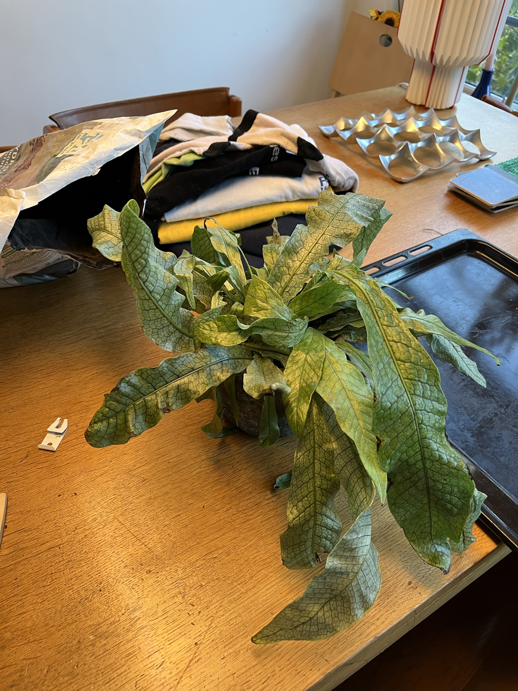

# Crocodile Fern: journal

Newest entry first. Each entry mirrors one toggle in the Notion page.

## 2026-10-12: First photos 📸

On the dining table. Looks stressed: the fronds are pale yellow-green and limp. Next step: feel the soil. Wet means overwatering, so let the top third dry; bone dry means water thoroughly. Keep it away from cold windows and radiators.

