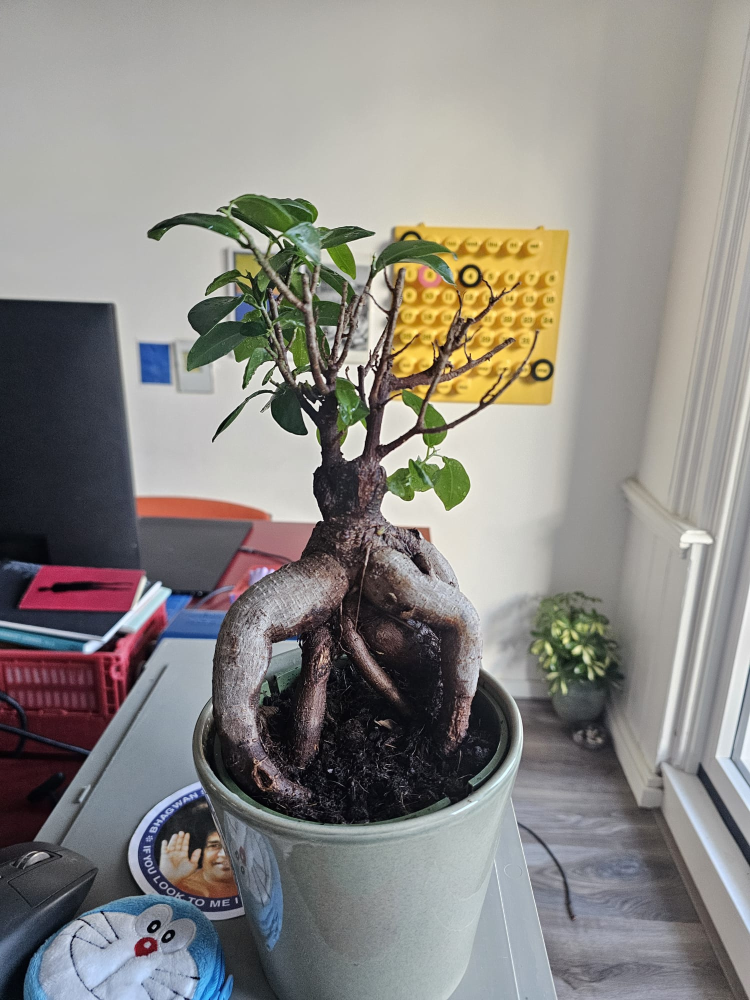
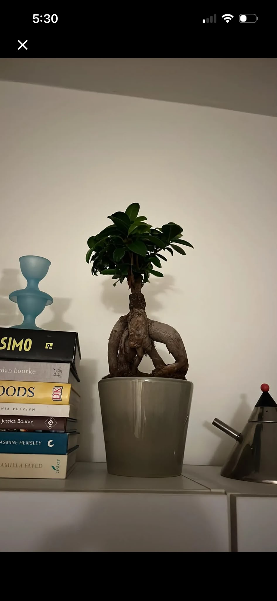

# Ficus Ginseng: journal

Newest entry first. Each entry mirrors one toggle in the Notion page.

## 2026-10-10: New home in a nursery pot 🪴

Moved into a plastic nursery pot inside the grey cachepot, so that excess water drains.
The canopy is thinner than in April, and some twigs on the right side are bare.

## 2026-04-15: First photo 🌱

Dense, compact canopy. On a shelf, directly in the glazed grey pot.

