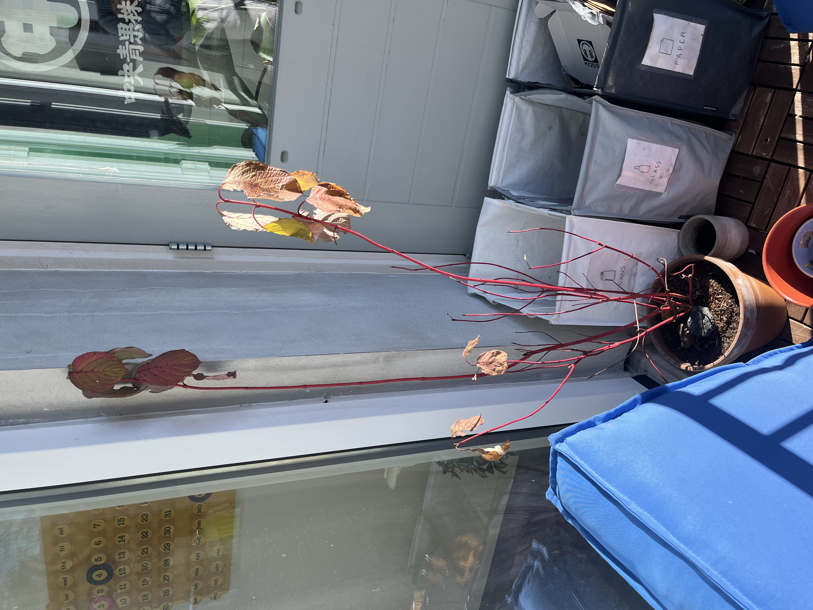
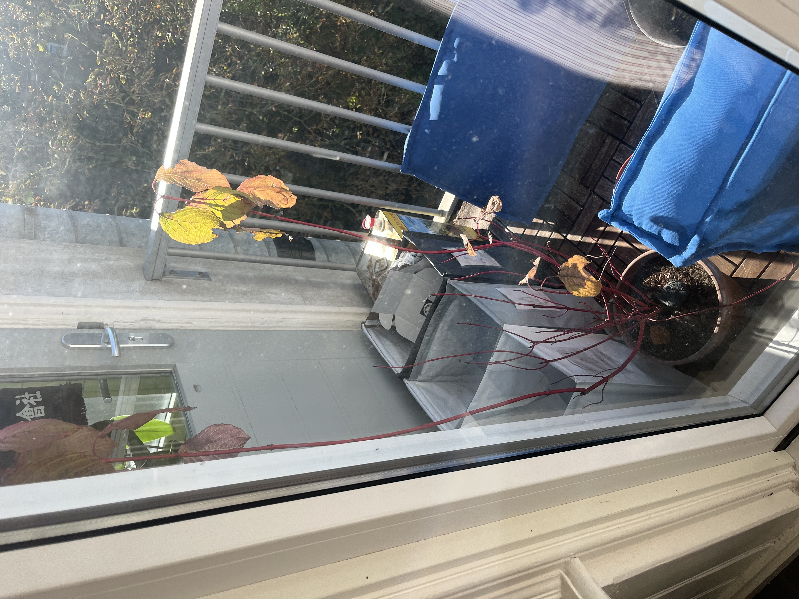
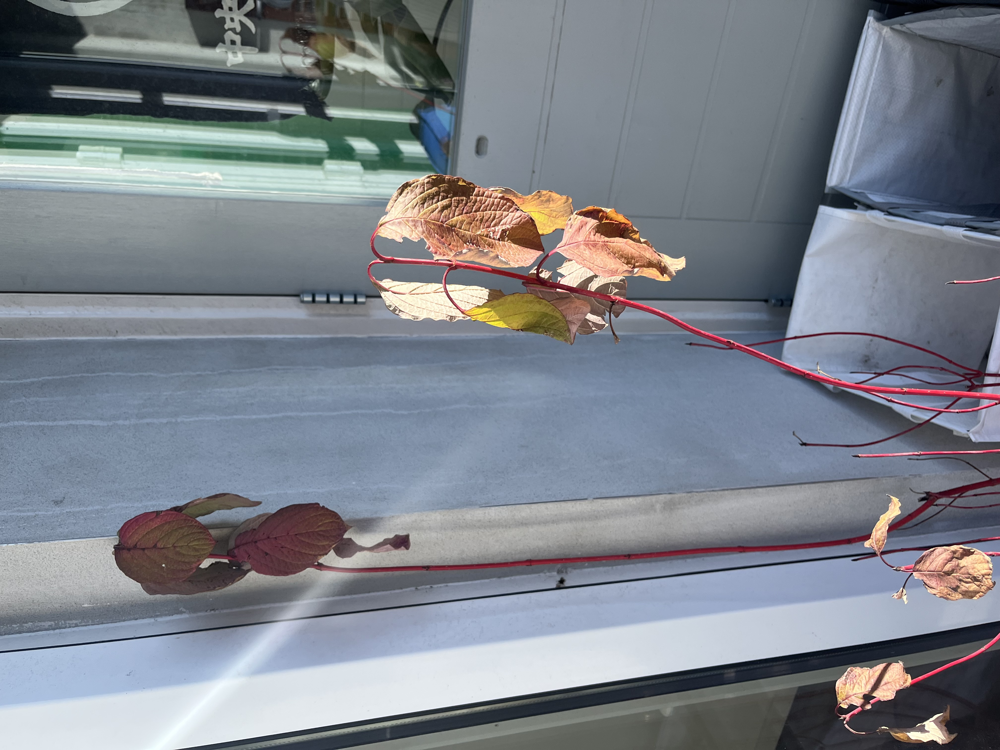
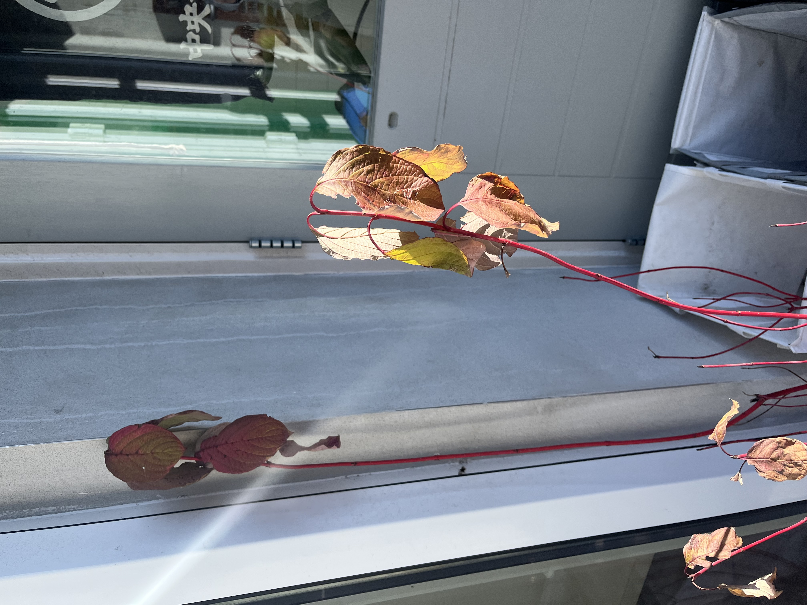
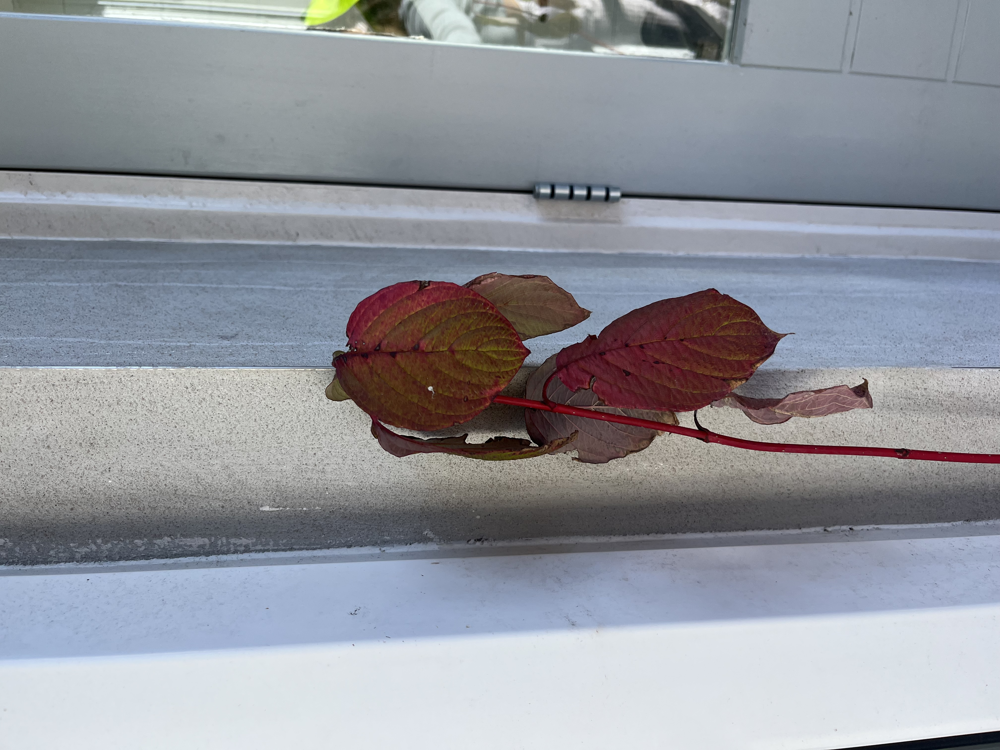

# Red Osier Dogwood: journal

Newest entry first. Each entry mirrors one toggle in the Notion page.

## 2026-10-12: First photos 📸

On the south-east facing balcony in Amsterdam, in a terracotta pot.
About five red stems, roughly 1–1.5 m tall, with leaves left only at the tips. The leaves are turning red, yellow and brown: normal autumn leaf drop.

## 2026-09-12: Welcome home 🪴

Bought in Amsterdam, about a month before the first photos (date approximate).
