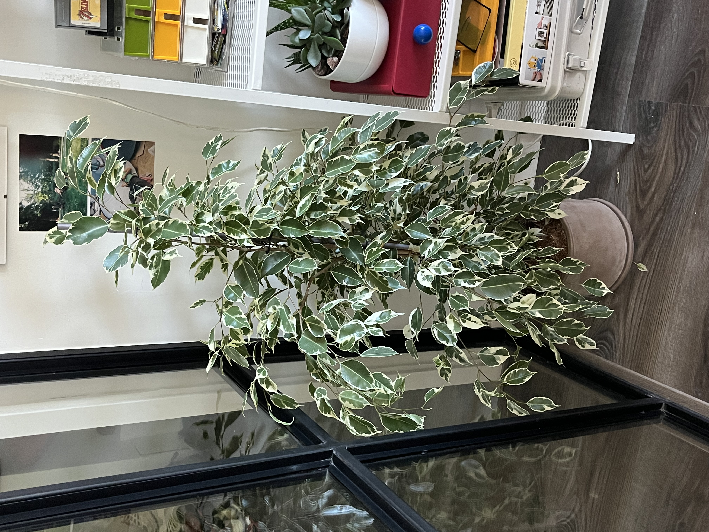

# Variegated Weeping Fig: journal

Newest entry first. Each entry mirrors one toggle in the Notion page.

## 2026-10-12: Settled in 🌿

A month in, and she has only dropped a few leaves. Staying in her corner next to the glass wall.
Full, bushy canopy of cream-edged leaves, about 1.2 m tall, in a grey pot on the floor.

## 2026-09-12: Welcome home 🪴

Bought at Intratuin Amsterdam (date approximate: "a month ago").
